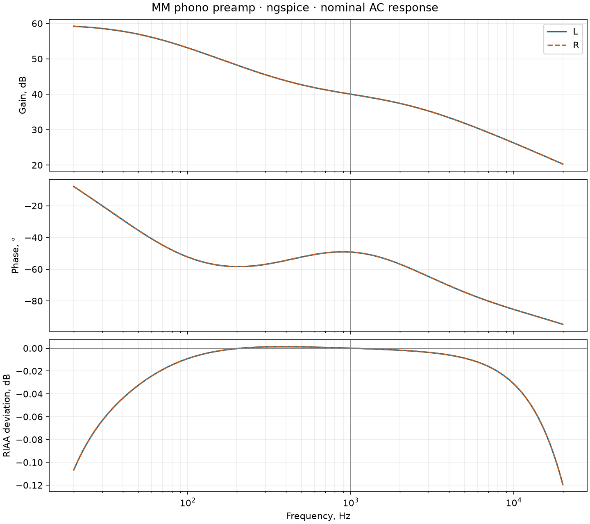

# NE5532 Balanced Phono Preamplifier

[Русская версия](README_ru.md)

A stereo moving-magnet phono preamplifier for the Audio-Technica AT-3600L,
using NE5532 operational amplifiers and RIAA playback equalization.
The main design has balanced inputs from floating cartridge coils and
conventional, ground-referenced line outputs. An earlier unbalanced design
is retained for comparison.

## Design

Each channel uses two input amplifiers with a shared gain-setting bridge,
followed by a differential amplifier with the 75 µs RIAA pole. The stereo
design uses three dual NE5532 packages and a ±12 V supply.

| Parameter | Nominal design |
| --- | --- |
| Cartridge | Audio-Technica AT-3600L, moving magnet |
| Differential input load | 47 kΩ in the midband: 23.5 kΩ from each input to GND |
| Input coupling | 4.7 µF per leg |
| Input amplifier feedback | 90.9 kΩ in parallel with a series 10 kΩ / 31.5 nF branch |
| Gain bridge | 182 Ω in series with two back-to-back 1000 µF capacitors |
| Differential amplifier | Four 10 kΩ resistors and two matched 7.5 nF capacitors per channel |
| Line output | 100 Ω, series 4.7 µF, 100 kΩ to GND |
| Power | ±12 V, supplied through J3 |

The bridge capacitors have their negative terminals joined at a floating
midpoint. Their linear series equivalent is 500 µF. The L− and R− cartridge
connections remain separate from GND; cable shields and the tonearm ground
are separate connections.

With the nominal values in `scripts/config.toml` and an external 47 kΩ load,
the ideal model gives 100.723 V/V (40.063 dB) at 1 kHz. A 4 mV RMS
differential input gives approximately 0.403 V RMS at that frequency.
The ideal RIAA deviation, normalized at 1 kHz, is −0.0683 to +0.0018 dB
over 20 Hz–20 kHz.

## Project status and model limits

PCB routing is complete; hardware measurements are still pending. Component
ratings and purchased parts must be checked before assembly.
The separate LM317/LM337 power supply is documented in
LaTeX; the KiCad preamplifier schematic receives regulated ±12 V and does
not include that regulator circuit.

The Python tools compare an analytical transfer function with a nodal model
and estimate the effect of a single-pole op-amp model. These calculations
do not establish measured noise, THD, stability, overload margin or CMRR.
They omit cartridge impedance, cable capacitance, component tolerances,
capacitor leakage and nonlinearity, and PCB parasitics.

## Files

| Path | Contents |
| --- | --- |
| `PreAmp.kicad_pro`, `PreAmp.kicad_sch` | Main KiCad project and schematic |
| `channel.kicad_sch`, `arm.kicad_sch`, `power.kicad_sch` | Active hierarchical sheets; earlier variants are kept separately |
| `PreAmp.net` | Exported netlist snapshot; may lag behind the schematic |
| `out/` | Condensed netlists, BOM and audit snapshots for quick inspection |
| `scripts/` | Python models, plotting tools, dependencies and `config.toml` |
| `docs/latex/` | Circuit documents, shared LaTeX support files and PDF snapshots |
| `docs/images/` | Published simulation plots in PNG, SVG and PDF |
| [docs/simulation/ngspice-2026-11-28/](docs/simulation/ngspice-2026-11-28/) | Archived ngspice results, source netlists and run parameters |
| [docs/PHONO_GUIDE.pdf](docs/PHONO_GUIDE.pdf) | Detailed design guide in Russian; source: [PHONO_GUIDE.tex](docs/PHONO_GUIDE.tex) |
| [docs/POWER.md](docs/POWER.md) | Preliminary transformer notes; actual voltages and phasing require verification |
| `docs/scheme/` | Reference scans for the Melodiya-103 player |
| `build/` | Generated calculations, plots, check reports and document builds; ignored by Git |

Use the current KiCad schematic to establish connectivity and
`scripts/config.toml` for the calculation parameters. KiCad, TOML and LaTeX
are maintained independently; changing one does not update the others.
Historical filenames containing `ballanced` and `ad3600l` are preserved.

## Run the calculations

Use Python 3.11 or newer. Run these commands from the repository root:

```sh
python3 -m venv scripts/.venv
scripts/.venv/bin/python -m pip install -e scripts
scripts/.venv/bin/python scripts/calculate_balanced_riaa.py
scripts/.venv/bin/python scripts/calculate_unbalanced_riaa.py
scripts/.venv/bin/python scripts/render_phono_guide.py
```

Dependencies are declared in `scripts/pyproject.toml`. Both calculation
scripts load `scripts/config.toml` by default and write CSV, JSON, PNG and
PDF results to `build/balanced_riaa/`, including the unbalanced results.
The guide renderer writes to `build/phono_guide/`.

To choose a configuration and output directory explicitly:

```sh
scripts/.venv/bin/python scripts/calculate_balanced_riaa.py \
  --config scripts/config.toml --output-dir build/check
```

## Run the QSPICE simulation on Windows

Install Python 3.11 or later, KiCad with `kicad-cli.exe`, and QSPICE with
`QSPICE64.exe`. Open PowerShell in the project root and run:

```powershell
python -m pip install -e scripts
python scripts/simulate_qspice.py
```

Install the Python dependencies once per environment. Save your changes in
KiCad before each run. The script exports the saved hierarchical schematic
`PreAmp.kicad_sch` to fresh XML and builds the SPICE netlists from that export.
Component values and connections come from this XML, so there is no need to
regenerate `PreAmp.net`.

The [`[qspice]` section of the TOML file](scripts/config.toml) controls the
output directory, report and plot generation, and optional overrides for
frequency range, point count, RIAA reference frequency, and external load.
Set `kicad_cli` and `qspice64` there if automatic detection misses your
installation, or pass `--kicad-cli` and `--qspice64` on the command line.
Use `--config path/to/config.toml` for a separate set of settings. Setting
`write_plots = false` allows running without Matplotlib.

Each run prints the path to its results directory (by default,
`build/qspice/run-*/`). Open `report.md` for gain at the reference frequency
and the RIAA error extrema and their frequencies. Open `response.png` or
`response.svg` for both channels' gain, phase, and RIAA error. The directory
also contains per-channel CSV, CIR and QRAW files and the KiCad XML export.

The script generates a linear, single-pole NE5532 approximation from the
existing `[opamp]` settings (default open-loop gain 100,000 and GBW 12 MHz).
It estimates gain and phase with an ideal differential source. Cartridge
impedance, cable capacitance, noise, and output clipping are outside this
model.

## Run ngspice independently

Install ngspice and KiCad CLI, then run from the project root:

```sh
python scripts/simulate_ngspice.py
```

This exports the saved KiCad schematic and runs both channels without a
previous QSPICE run. On Linux and Windows, native ngspice is used when found
on `PATH`. On Windows, `backend = "auto"` falls back to ngspice inside WSL;
KiCad CLI still runs on the host. Use `--backend native` or `--backend wsl`
to select explicitly.

The [`[ngspice]` section](scripts/config.toml) controls the backend, output
directory, report/plot switches, timeout and optional overrides of the
`[analysis]` frequency range, reference frequency, load and point count.
`points` controls the target logarithmic sweep density; the exact sample
count can differ because SPICE uses an integer number of points per decade.
Executable paths can be set with `ngspice`/`kicad_cli` or the CLI options
`--ngspice`/`--kicad-cli`. `wsl_distro` or `--distro` selects the WSL distribution.
CLI options take priority. Paths in TOML are relative to the project root;
an executable's bare name is looked up on `PATH`.

```sh
python scripts/simulate_ngspice.py --config scripts/config.toml --backend native
python scripts/compare_ngspice.py build/qspice/run-example --backend native
```

Results go to a new `build/ngspice/run-*/` directory: per-channel CSV
(gain, phase and RIAA error), DAT (frequency and complex voltage), CIR and
logs, plus the KiCad XML, original configuration and effective run metadata.
With `write_report = true`, `report.md` and `report.json` contain the gain
and RIAA extrema; with `write_plots = true`, `response.png` and `response.svg`
show gain, phase and RIAA error for both channels. Disable plots to run
without Matplotlib. Comparison mode retains its per-channel comparison CSV
and uses the same ngspice backend settings without modifying the QSPICE decks.

Both simulators use the same linear one-pole op-amp approximation described
above. These plots do not predict noise, distortion, overload or real-device
stability.

## Published ngspice results — 28 November 2026

The snapshot below comes from `build/ngspice/run-_ttt3q4u`, using ngspice
45.2 with the KiCad-exported component values and connections. The input is
an ideal differential source; the external load is 47 kΩ per channel.
The sweep covers 20 Hz–20 kHz with 1003 samples per channel. RIAA deviation
is normalized at 1 kHz. The one-pole op-amp model uses A₀ = 100,000 and
GBW = 12 MHz.

| Quantity | Left | Right |
| --- | ---: | ---: |
| Gain at 1 kHz, V/V | 100.23888 | 100.23888 |
| Gain at 1 kHz, dB | 40.02072 | 40.02072 |
| Minimum RIAA deviation, dB | −0.11942 at 20 kHz | −0.11942 at 20 kHz |
| Maximum RIAA deviation, dB | +0.00131 at 382.36 Hz | +0.00131 at 382.36 Hz |



The top panel shows the intended RIAA playback response; the falling gain
with frequency is part of the equalization. The middle panel shows signal
phase, and the bottom panel shows deviation from the RIAA reference after
removing the gain difference at 1 kHz. For a 4 mV RMS differential input,
the modeled output at 1 kHz is approximately 0.401 V RMS.

The L/R curves overlap because the simulation uses matched nominal parts
and identical op-amp parameters, without component tolerances. This does
not establish real channel matching or CMRR. The finite open-loop gain
makes this result slightly different from the ideal-op-amp calculation
above. The KiCad snapshot also uses 23.51 kΩ and 90.91 kΩ resistor sums,
where the analytical configuration uses rounded 23.5 kΩ and 90.9 kΩ values.
Cartridge/cable impedance, PCB parasitics, noise, distortion, clipping and
real-device stability are outside this model.

The [archived data and reproduction notes](docs/simulation/ngspice-2026-11-28/README.md)
include CSV/DAT results, SPICE decks, the KiCad XML, configuration and run
metadata. The [balanced circuit PDF](docs/latex/ne5532_ad3600l_ballanced.pdf)
and [design guide](docs/PHONO_GUIDE.pdf) include the same results and comments.

## Build the documents

Install XeLaTeX, latexmk and the TeX packages used by the documents, including
TikZ/PGFPlots, fontspec and polyglossia. The shared preamble requires
Times New Roman, Arial and Courier New. A local circuitikz style is included.
Generate the calculations and guide figures above before building.

From the repository root:

```sh
TEXINPUTS=.:./docs/latex//: latexmk -xelatex -interaction=nonstopmode \
  -halt-on-error -outdir=build/latex docs/latex/ne5532_ad3600l_ballanced.tex
TEXINPUTS=.:./docs/latex//: latexmk -xelatex -interaction=nonstopmode \
  -halt-on-error -outdir=build/latex docs/latex/ne5532_at3600l.tex
TEXINPUTS=.:./docs/latex//: latexmk -xelatex -interaction=nonstopmode \
  -halt-on-error -outdir=build/latex docs/latex/analog_power_lm317_lm337.tex
TEXINPUTS=.:./docs/latex//: latexmk -xelatex -interaction=nonstopmode \
  -halt-on-error -outdir=build/phono_guide docs/PHONO_GUIDE.tex
```

The trailing colon in `TEXINPUTS` preserves the system TeX search path.
New PDFs remain in `build/`; checked-in PDF snapshots under `docs/` are
updated manually. Some existing documents contain commands from an earlier
directory layout; use the commands in this README for the current layout.

## Check the KiCad schematic

The project was last checked with KiCad 10.0.8. Save changes in the editor
before exporting or running ERC:

```sh
mkdir -p build/review
kicad-cli sch erc --format json --severity-all \
  --output build/review/erc.json PreAmp.kicad_sch
kicad-cli sch export netlist --format kicadsexpr \
  --output build/review/PreAmp.net PreAmp.kicad_sch
```

ERC checks enabled electrical rules. It does not validate component ratings,
footprint dimensions, equalization accuracy, stability or PCB layout.
