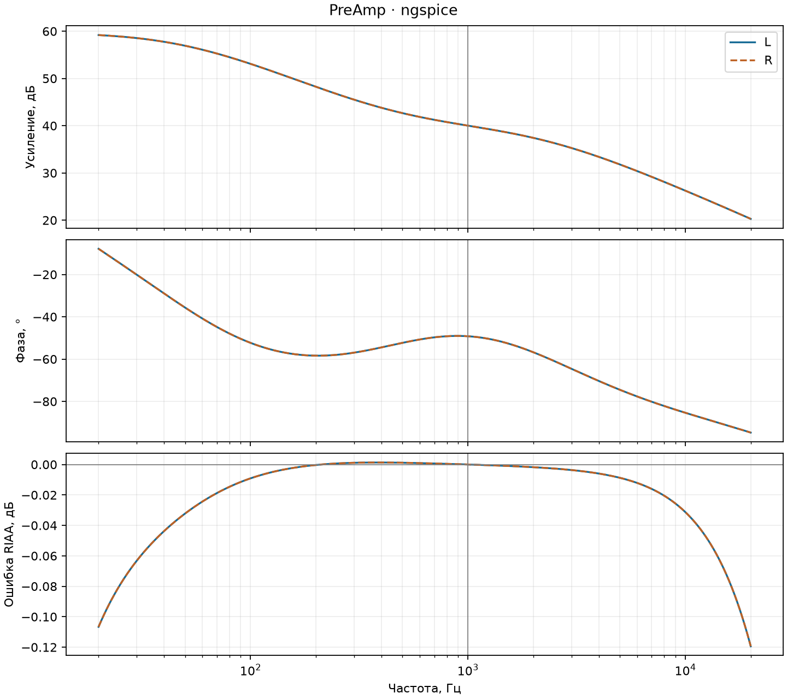

# Балансный фонокорректор на NE5532

[English version](README.md)

Стереофонический фонокорректор для магнитной головки Audio-Technica AT-3600L
на операционных усилителях NE5532 с коррекцией воспроизведения RIAA.
Основной вариант имеет балансные входы от плавающих катушек головки
и обычные линейные выходы относительно земли. Ранний небалансный вариант
сохранён отдельно для сравнения.

## Схема

На каждый канал приходятся два входных усилителя с общим мостом задания
усиления и разностный каскад с полюсом RIAA 75 мкс. На стерео используются
три двухканальных корпуса NE5532. Питание — ±12 В.

| Параметр | Расчётный вариант |
| --- | --- |
| Головка | Audio-Technica AT-3600L, MM |
| Дифференциальная входная нагрузка | 47 кОм в средней полосе: по 23,5 кОм от каждого входа к GND |
| Входные разделительные конденсаторы | По 4,7 мкФ в каждом плече |
| Обратная связь входных ОУ | 90,9 кОм параллельно последовательной цепи 10 кОм / 31,5 нФ |
| Мост задания усиления | 182 Ом последовательно с двумя встречными конденсаторами по 1000 мкФ |
| Разностный каскад | Четыре резистора 10 кОм и две согласованные ёмкости 7,5 нФ на канал |
| Линейный выход | 100 Ом, последовательно 4,7 мкФ, 100 кОм к GND |
| Питание | Готовые ±12 В через J3 |

Электролиты моста соединены минусами вместе, средняя точка плавающая.
Эквивалентная ёмкость последовательной пары в линейной модели — 500 мкФ.
Возвраты катушек L− и R− не соединяются с GND; экраны кабеля и земля
тонарма подключаются отдельно.

При номиналах `scripts/config.toml` и внешней нагрузке 47 кОм идеальная
модель даёт 100,723 В/В, или 40,063 дБ, на 1 кГц. Дифференциальному
входному сигналу 4 мВ RMS соответствует около 0,403 В RMS на этой частоте.
Идеальная ошибка RIAA после нормировки на 1 кГц составляет
−0,0683…+0,0018 дБ в полосе 20 Гц…20 кГц.

## Состояние проекта и границы расчёта

Трассировка платы завершена; измерения собранного устройства ещё предстоят.
Перед сборкой нужно проверить допустимые режимы и размеры купленных деталей.
Отдельный блок питания на LM317/LM337 описан в LaTeX. Схема предусилителя
KiCad принимает готовые ±12 В и не содержит этого блока стабилизаторов.

Python-скрипты сопоставляют аналитическую передаточную функцию с узловой
моделью и оценивают влияние однополюсной модели ОУ. Расчёт не подтверждает
измеренные шум, THD, устойчивость, запас по перегрузке или CMRR.
В нём не учитываются импеданс головки, ёмкость кабеля, разброс компонентов,
утечки и нелинейность конденсаторов, паразитные параметры платы.

## Структура

| Путь | Содержимое |
| --- | --- |
| `PreAmp.kicad_pro`, `PreAmp.kicad_sch` | Основной проект и схема KiCad |
| `channel.kicad_sch`, `arm.kicad_sch`, `power.kicad_sch` | Активные иерархические листы; ранние варианты сохранены отдельно |
| `PreAmp.net` | Экспортированный снимок нетлиста; может отставать от схемы |
| `out/` | Сокращённые нетлисты, BOM и снимки проверок для быстрого разбора |
| `scripts/` | Расчётные модели, графики, зависимости и `config.toml` |
| `docs/latex/` | Исходники схем, общие файлы LaTeX и сохранённые PDF |
| `docs/images/` | Опубликованные графики симуляции в PNG, SVG и PDF |
| [docs/simulation/ngspice-2026-11-28/](docs/simulation/ngspice-2026-11-28/) | Сохранённые результаты ngspice, исходные нетлисты и параметры прогона |
| [docs/PHONO_GUIDE.pdf](docs/PHONO_GUIDE.pdf) | Подробное руководство по проектированию; исходник — [PHONO_GUIDE.tex](docs/PHONO_GUIDE.tex) |
| [docs/POWER.md](docs/POWER.md) | Предварительные сведения о трансформаторе; реальные напряжения и фазировку нужно проверить |
| `docs/scheme/` | Справочные сканы схем и плат «Мелодии-103» |
| `build/` | Генерируемые расчёты, графики, отчёты и сборки документов; исключены из Git |

Фактические соединения нужно смотреть в актуальном KiCad, расчётные
параметры — в `scripts/config.toml`. KiCad, TOML и LaTeX ведутся независимо:
изменение одного файла не обновляет остальные. Исторические имена файлов
с `ballanced` и `ad3600l` сохранены.

## Запуск расчётов

Нужен Python 3.11 или новее. Все команды выполнять из корня репозитория:

```sh
python3 -m venv scripts/.venv
scripts/.venv/bin/python -m pip install -e scripts
scripts/.venv/bin/python scripts/calculate_balanced_riaa.py
scripts/.venv/bin/python scripts/calculate_unbalanced_riaa.py
scripts/.venv/bin/python scripts/render_phono_guide.py
```

Зависимости заданы в `scripts/pyproject.toml`. Оба расчётных скрипта
по умолчанию читают `scripts/config.toml` и сохраняют CSV, JSON, PNG и PDF
в `build/balanced_riaa/`, включая результаты небалансного варианта.
Иллюстрации руководства создаются в `build/phono_guide/`.

Конфигурацию и каталог результатов можно задать явно:

```sh
scripts/.venv/bin/python scripts/calculate_balanced_riaa.py \
  --config scripts/config.toml --output-dir build/check
```

## Симуляция в QSPICE под Windows

Понадобятся Python 3.11 или новее, KiCad с `kicad-cli.exe` и QSPICE с
`QSPICE64.exe`. В PowerShell из корня проекта выполни:

```powershell
python -m pip install -e scripts
python scripts/simulate_qspice.py
```

Зависимости Python устанавливаются один раз на окружение. Перед каждым
прогоном сохрани изменения в KiCad. Скрипт экспортирует сохранённую
иерархическую схему `PreAmp.kicad_sch` в свежий XML и строит из него
SPICE-нетлисты. Соединения и номиналы деталей берутся из этого XML, поэтому
перегенерировать `PreAmp.net` перед запуском не нужно.

В [секции `[qspice]` файла TOML](scripts/config.toml) задаются выходной каталог,
создание отчёта и графиков. Там же можно переопределить диапазон частот,
число точек, опорную частоту RIAA и внешнюю нагрузку. Если автообнаружение
программ не сработало, укажи `kicad_cli` и `qspice64` в этой секции или
передай `--kicad-cli` и `--qspice64` при запуске. Для отдельного набора
настроек используй `--config путь/к/config.toml`. С `write_plots = false`
прогон работает без Matplotlib.

Скрипт выводит путь к каталогу результатов (по умолчанию
`build/qspice/run-*/`). В `report.md` указаны усиление на опорной частоте
и экстремумы ошибки RIAA с их частотами. В `response.png` и `response.svg`
показаны усиление, фаза и ошибка RIAA для обоих каналов. В каталоге также
остаются CSV, CIR и QRAW для каждого канала и экспорт XML из KiCad.

Скрипт строит линейную однополюсную модель NE5532 по параметрам `[opamp]`
(по умолчанию усиление без обратной связи 100 000 и GBW 12 МГц). Она
позволяет оценить усиление и фазу с идеальным дифференциальным источником.
Импеданс головки, ёмкость кабеля, шум и ограничение выходного размаха
выходят за границы этой модели.

## Самостоятельный прогон ngspice

Установи ngspice и KiCad CLI, затем из корня проекта запусти:

```sh
python scripts/simulate_ngspice.py
```

Скрипт экспортирует сохранённую схему KiCad и рассчитывает оба канала;
предварительный прогон QSPICE не требуется. В Linux и Windows используется
native ngspice, если он найден через `PATH`. В Windows режим `backend = "auto"`
при его отсутствии пробует ngspice внутри WSL; KiCad CLI работает на основной
системе. Можно явно выбрать `--backend native` или `--backend wsl`.

В [секции `[ngspice]`](scripts/config.toml) задаются backend, выходной каталог,
создание отчёта и графиков, таймаут и независимые переопределения `[analysis]`:
диапазон частот, опорная частота, нагрузка и число точек. `points` задаёт
целевую плотность логарифмической сетки; фактическое число отсчётов может
отличаться из-за целого числа точек на декаду в SPICE.
Пути к программам задаются через `ngspice`/`kicad_cli` или CLI-флаги
`--ngspice`/`--kicad-cli`; `wsl_distro` или `--distro` выбирает дистрибутив WSL.
Флаги имеют приоритет. Пути внутри TOML считаются от корня проекта;
простое имя исполняемой программы ищется через `PATH`.

```sh
python scripts/simulate_ngspice.py --config scripts/config.toml --backend native
python scripts/compare_ngspice.py build/qspice/run-example --backend native
```

Каждый прогон создаёт `build/ngspice/run-*/`: CSV по каналам (усиление, фаза,
ошибка RIAA), DAT (частота и комплексное напряжение), CIR, логи, свежий XML,
копию конфига и фактические настройки прогона. С `write_report = true`
появляются `report.md` и `report.json` с усилением и экстремумами ошибки RIAA;
с `write_plots = true` — `response.png` и `response.svg` с АЧХ, фазой и ошибкой
RIAA обоих каналов. Без графиков Matplotlib не требуется.
Режим сравнения сохраняет CSV сравнения и использует те же настройки backend,
не изменяя исходные нетлисты QSPICE.

Оба симулятора используют описанную выше линейную однополюсную модель ОУ.
Эти графики не предсказывают шум, искажения, перегрузку или устойчивость
реального устройства.

## Результаты ngspice — 28 ноября 2026 года

Ниже опубликован прогон `build/ngspice/run-_ttt3q4u`, выполненный в ngspice
45.2 по соединениям и номиналам из экспорта KiCad. Вход возбуждается
идеальным дифференциальным источником, внешняя нагрузка каждого канала —
47 кОм. Диапазон — 20 Гц…20 кГц, по 1003 отсчёта на канал, ошибка RIAA
нормирована на 1 кГц. Однополюсная модель ОУ: A₀ = 100 000, GBW = 12 МГц.

| Величина | Левый канал | Правый канал |
| --- | ---: | ---: |
| Усиление на 1 кГц, В/В | 100,23888 | 100,23888 |
| Усиление на 1 кГц, дБ | 40,02072 | 40,02072 |
| Минимальная ошибка RIAA, дБ | −0,11942 на 20 кГц | −0,11942 на 20 кГц |
| Максимальная ошибка RIAA, дБ | +0,00131 на 382,36 Гц | +0,00131 на 382,36 Гц |



Верхний график показывает требуемую характеристику воспроизведения RIAA:
спад усиления с частотой заложен в коррекции. Средний — фазу сигнала,
нижний — отклонение от эталона RIAA после исключения разницы усиления
на 1 кГц. При дифференциальном входном сигнале 4 мВ RMS модель даёт
около 0,401 В RMS на выходе на 1 кГц.

Кривые L/R совпадают, поскольку номиналы и параметры ОУ одинаковы,
а разброс деталей не задан. Это не подтверждает реальное согласование
каналов или CMRR. Конечное усиление ОУ немного меняет результат относительно
идеального расчёта выше. Кроме того, в снимке KiCad используются сборки
23,51 кОм и 90,91 кОм, а в аналитической конфигурации — округлённые
23,5 кОм и 90,9 кОм. Импеданс головки и кабеля, паразитные параметры PCB,
шум, искажения, ограничение размаха и реальная устойчивость здесь не моделируются.

В [архиве данных и инструкции воспроизведения](docs/simulation/ngspice-2026-11-28/README_ru.md)
сохранены CSV/DAT, SPICE-нетлисты, XML KiCad, конфигурация и параметры
прогона. Те же результаты с пояснениями добавлены в
[PDF балансной схемы](docs/latex/ne5532_ad3600l_ballanced.pdf) и
[руководство](docs/PHONO_GUIDE.pdf).

## Сборка документов

Нужны XeLaTeX, latexmk и используемые документами пакеты TeX, в том числе
TikZ/PGFPlots, fontspec и polyglossia. Общая преамбула требует шрифты
Times New Roman, Arial и Courier New. Локальный стиль circuitikz включён
в проект. Перед сборкой выполнить расчёты и генерацию иллюстраций выше.

Из корня репозитория:

```sh
TEXINPUTS=.:./docs/latex//: latexmk -xelatex -interaction=nonstopmode \
  -halt-on-error -outdir=build/latex docs/latex/ne5532_ad3600l_ballanced.tex
TEXINPUTS=.:./docs/latex//: latexmk -xelatex -interaction=nonstopmode \
  -halt-on-error -outdir=build/latex docs/latex/ne5532_at3600l.tex
TEXINPUTS=.:./docs/latex//: latexmk -xelatex -interaction=nonstopmode \
  -halt-on-error -outdir=build/latex docs/latex/analog_power_lm317_lm337.tex
TEXINPUTS=.:./docs/latex//: latexmk -xelatex -interaction=nonstopmode \
  -halt-on-error -outdir=build/phono_guide docs/PHONO_GUIDE.tex
```

Завершающее двоеточие в `TEXINPUTS` сохраняет системный поиск TeX.
Новые PDF остаются в `build/`; сохранённые PDF в `docs/` обновляются вручную.
В некоторых документах остались команды для прежнего расположения файлов;
для текущей структуры использовать команды из этого README.

## Проверка схемы KiCad

Последняя проверка проекта выполнялась в KiCad 10.0.8. Перед экспортом
и ERC сохранить изменения в редакторе:

```sh
mkdir -p build/review
kicad-cli sch erc --format json --severity-all \
  --output build/review/erc.json PreAmp.kicad_sch
kicad-cli sch export netlist --format kicadsexpr \
  --output build/review/PreAmp.net PreAmp.kicad_sch
```

ERC проверяет включённые электрические правила. Он не подтверждает
допустимые режимы компонентов, размеры посадочных мест, точность коррекции,
устойчивость или качество разводки.
