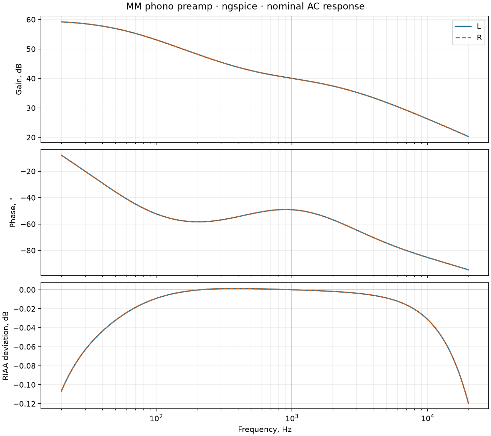

# Nominal AC simulation — 28 November 2026

[Русская версия](README_ru.md)

This is a frozen copy of `build/ngspice/run-_ttt3q4u`, produced by ngspice
45.2 (native Linux). The circuit comes from the saved KiCad schematic;
this is a linear simulation, not a measurement of the routed PCB.

## Conditions and results

The external load is 47 kΩ per channel, in parallel with the circuit's
100 kΩ output bleed resistor. The sweep covers 20 Hz–20 kHz with 1003
samples per channel (`.ac dec 334`). The configured target was 1001 points;
SPICE uses an integer number of samples per decade. The reported gain at
1 kHz is interpolated in dB against log frequency when necessary.

| Quantity | Left | Right |
| --- | ---: | ---: |
| Gain at 1 kHz, V/V | 100.23888 | 100.23888 |
| Gain at 1 kHz, dB | 40.02072 | 40.02072 |
| Minimum RIAA deviation | −0.11942 dB at 20 kHz | −0.11942 dB at 20 kHz |
| Maximum RIAA deviation | +0.00131 dB at 382.36 Hz | +0.00131 dB at 382.36 Hz |



The decreasing gain in the top panel is the intended RIAA playback
response. The bottom panel removes both the simulated and reference
responses' gain at 1 kHz before comparing their shapes. The RIAA time
constants are 3180, 318 and 75 µs. A 4 mV RMS differential input corresponds
to approximately 0.401 V RMS at the output at 1 kHz in this linear model.

The SPICE AC sources are +0.5 V and −0.5 V, giving a 1 V differential
excitation for the active channel; the other channel has zero excitation.
This is transfer-function normalization, not a large-signal test.

The op-amp approximation is
`A(s) = A0 / (1 + s*A0/(2*pi*GBW))`, with A0 = 100,000 and GBW = 12 MHz.
Outputs and supplies are ideal; ±12 V supply sources do not limit output
swing or contribute noise. `rshunt = 1e12 Ω` provides a DC path at floating
capacitor junctions. KiCad values include resistor sums of 23.51 kΩ and
90.91 kΩ; the analytical TOML model uses rounded 23.5 kΩ and 90.9 kΩ.

Both channels use identical nominal parts and model parameters, so their
curves overlap. Component tolerances, cartridge/cable impedance, PCB
parasitics, noise, distortion, clipping and real-device stability are not
included. Neither real channel matching nor CMRR is established here.

## Archived files

| File | Meaning |
| --- | --- |
| [PreAmp.xml](PreAmp.xml) | KiCad-exported connectivity and component values used for this run |
| [config.toml](config.toml), [run_info.json](run_info.json) | Original configuration and effective model/run settings |
| [report.json](report.json) | Unrounded gain and RIAA extrema |
| [preamp_l.csv](preamp_l.csv), [preamp_r.csv](preamp_r.csv) | Frequency, gain in V/V and dB, phase in degrees and normalized RIAA deviation |
| [preamp_l.dat](preamp_l.dat), [preamp_r.dat](preamp_r.dat) | ngspice output: frequency and complex output voltage |
| [preamp_l.cir](preamp_l.cir), [preamp_r.cir](preamp_r.cir) | Stereo SPICE decks, exciting L or R respectively |
| [preamp_l-ngspice.txt](preamp_l-ngspice.txt), [preamp_r-ngspice.txt](preamp_r-ngspice.txt) | Original simulator logs, renamed from `.log` to `.txt` |
| [manifest.json](manifest.json) | Source run, published filenames and SHA-256 hashes of copied artifacts |

Plots are published in [docs/images](../../images/): the original Russian
PNG/SVG, a vector PDF converted from that SVG for LaTeX, and an English
PNG/SVG drawn from the same archived CSV. Numerical data were not changed.
`plot_english.py` recreates the English plots with Matplotlib:

```sh
scripts/.venv/bin/python docs/simulation/ngspice-2026-11-28/plot_english.py
```

## Replay the archived circuit

To reproduce the exact frozen circuit without re-exporting today's KiCad
schematic, run the decks in a separate build directory. From the repository
root on Linux:

```sh
mkdir -p build/ngspice/replay-2026-11-28
cp docs/simulation/ngspice-2026-11-28/preamp_?.cir build/ngspice/replay-2026-11-28/
cd build/ngspice/replay-2026-11-28
ngspice -n -b preamp_l.cir
ngspice -n -b preamp_r.cir
```

The decks write `preamp_l.dat` and `preamp_r.dat` in the working directory.
For a new run from the current saved schematic, use
`scripts/.venv/bin/python scripts/simulate_ngspice.py` from the repository
root instead. A later schematic or configuration may produce different results.
