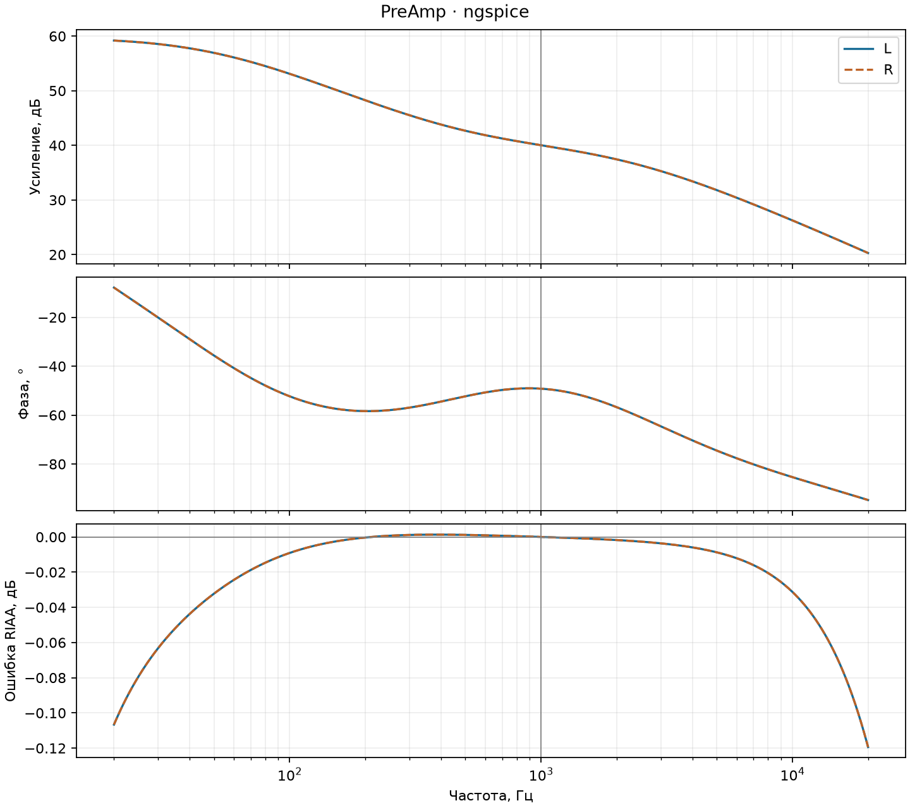

# Номинальный AC-анализ — 28 ноября 2026 года

[English version](README.md)

Здесь сохранён прогон `build/ngspice/run-_ttt3q4u`, выполненный в ngspice
45.2 (native Linux). Схема взята из сохранённого KiCad. Это линейная
симуляция, а не измерение разведённой платы.

## Условия и результаты

Внешняя нагрузка — 47 кОм на канал, параллельно выходному резистору
100 кОм. Диапазон — 20 Гц…20 кГц, по 1003 отсчёта на канал
(`.ac dec 334`). В конфигурации запрошено 1001 точка; SPICE задаёт целое
число отсчётов на декаду. При необходимости усиление на 1 кГц
интерполируется в дБ по логарифму частоты.

| Величина | Левый канал | Правый канал |
| --- | ---: | ---: |
| Усиление на 1 кГц, В/В | 100,23888 | 100,23888 |
| Усиление на 1 кГц, дБ | 40,02072 | 40,02072 |
| Минимальная ошибка RIAA | −0,11942 дБ на 20 кГц | −0,11942 дБ на 20 кГц |
| Максимальная ошибка RIAA | +0,00131 дБ на 382,36 Гц | +0,00131 дБ на 382,36 Гц |



Спад усиления на верхнем графике соответствует требуемой коррекции
воспроизведения RIAA. На нижнем графике сравниваются формы расчётной и
эталонной АЧХ после нормировки обеих на 1 кГц. Постоянные времени эталона:
3180, 318 и 75 мкс. В этой линейной модели дифференциальному входному
сигналу 4 мВ RMS соответствует около 0,401 В RMS на выходе на 1 кГц.

AC-источники SPICE задают +0,5 В и −0,5 В, то есть 1 В между входами
возбуждаемого канала; второй канал не возбуждается. Это нормировка
передаточной функции, а не проверка большого сигнала.

Приближение ОУ:
`A(s) = A0 / (1 + s*A0/(2*pi*GBW))`, где A0 = 100 000, GBW = 12 МГц.
Выходы и питание идеальны: источники ±12 В не ограничивают размах
и не вносят шум. `rshunt = 1e12 Ом` задаёт DC-путь плавающим средним
точкам конденсаторов. В KiCad используются сборки 23,51 кОм и 90,91 кОм;
аналитическая TOML-модель использует округлённые 23,5 кОм и 90,9 кОм.

Кривые каналов совпадают из-за одинаковых номиналов и параметров модели.
Разброс деталей, импеданс головки и кабеля, паразитные параметры PCB,
шум, искажения, ограничение размаха и реальная устойчивость не учитываются.
Реальное согласование каналов и CMRR этим расчётом не подтверждаются.

## Сохранённые файлы

| Файл | Содержимое |
| --- | --- |
| [PreAmp.xml](PreAmp.xml) | Соединения и номиналы из экспорта KiCad, использованные в прогоне |
| [config.toml](config.toml), [run_info.json](run_info.json) | Исходная конфигурация и фактические параметры модели/прогона |
| [report.json](report.json) | Усиление и экстремумы ошибки RIAA без округления |
| [preamp_l.csv](preamp_l.csv), [preamp_r.csv](preamp_r.csv) | Частота, усиление в В/В и дБ, фаза в градусах, нормированная ошибка RIAA |
| [preamp_l.dat](preamp_l.dat), [preamp_r.dat](preamp_r.dat) | Вывод ngspice: частота и комплексное выходное напряжение |
| [preamp_l.cir](preamp_l.cir), [preamp_r.cir](preamp_r.cir) | SPICE-нетлисты стереосхемы с возбуждением L или R соответственно |
| [preamp_l-ngspice.txt](preamp_l-ngspice.txt), [preamp_r-ngspice.txt](preamp_r-ngspice.txt) | Исходные логи симулятора с расширением `.txt` вместо `.log` |
| [manifest.json](manifest.json) | Исходный прогон, опубликованные имена и SHA-256 перенесённых файлов |

Графики находятся в [docs/images](../../images/): исходные PNG/SVG с
русскими подписями, векторный PDF из этого SVG для LaTeX и PNG/SVG с
английскими подписями из тех же CSV. Числовые данные не менялись.
Скрипт `plot_english.py` пересоздаёт английские графики через Matplotlib:

```sh
scripts/.venv/bin/python docs/simulation/ngspice-2026-11-28/plot_english.py
```

## Повторить именно сохранённую схему

Для воспроизведения этого снимка не нужно экспортировать сегодняшнюю
схему заново. Нетлисты запускать в отдельном каталоге сборки. Из корня
репозитория в Linux:

```sh
mkdir -p build/ngspice/replay-2026-11-28
cp docs/simulation/ngspice-2026-11-28/preamp_?.cir build/ngspice/replay-2026-11-28/
cd build/ngspice/replay-2026-11-28
ngspice -n -b preamp_l.cir
ngspice -n -b preamp_r.cir
```

Нетлисты запишут `preamp_l.dat` и `preamp_r.dat` в текущий каталог.
Для нового прогона по актуальному сохранённому KiCad использовать
`scripts/.venv/bin/python scripts/simulate_ngspice.py` из корня проекта.
После изменений схемы или конфигурации результаты могут отличаться.
